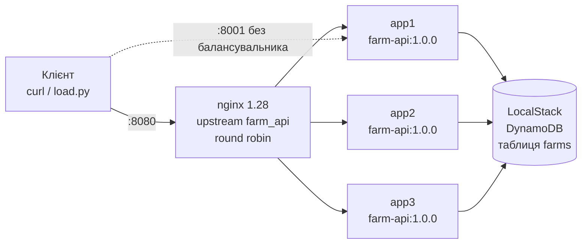

# Farm API за балансувальником навантаження

Три екземпляри контейнеризованого Farm API (з ЛР-8) за nginx. Дані зберігаються в DynamoDB у LocalStack, тому всі екземпляри працюють зі спільною таблицею. Єдина точка входу — `http://localhost:8080`.

## Архітектура



Усі сервіси запускаються одним `docker compose` у спільній мережі. Порти `8001–8003` відкрито лише для порівняння з роботою без балансувальника.

## Застосунок

Контейнер (`Dockerfile`) містить HTTP-сервер `app/server.py` і **той самий** Lambda-обробник `serverless/lambda/handler.py` з ЛР-8. Сервер перетворює HTTP-запит на подію API Gateway і викликає обробник, тому логіка роботи з фермами не змінилася. Обробник підключається через додатковий контекст збірки (`additional_contexts`), а не копіюється.

| Метод | Шлях | Відповідь |
| --- | --- | --- |
| `GET` | `/` | `{"instance": "app1", ...}` — ідентифікатор екземпляра |
| `GET` | `/health` | `200 {"status": "ok"}` або `503`, якщо DynamoDB недоступна |
| `GET` | `/work?ms=100` | імітація обробки запиту заданої тривалості |
| `GET`, `POST` | `/farms` | список / створення ферми (ЛР-8) |
| `GET`, `DELETE` | `/farms/{id}` | отримання / видалення ферми (ЛР-8) |

Кожна відповідь має заголовок `X-Instance-Id`, а nginx додає `X-Upstream` з адресою екземпляра. Ідентифікатор задається змінною оточення `INSTANCE_ID`.

Кожен екземпляр обробляє запити по одному, як один процес-обробник. Тому пропускна здатність системи залежить від кількості екземплярів, і ефект балансування видно в порівнянні.

## Балансувальник

`nginx/nginx.conf`:

- `upstream farm_api` з трьома серверами, алгоритм **round robin** (по черзі);
- **пасивна перевірка**: `max_fails=1 fail_timeout=10s` — після невдалої спроби екземпляр виключається на 10 с;
- **повтор**: `proxy_next_upstream error timeout http_502 http_503 http_504` — запит, який не вдалося обробити, nginx одразу передає наступному екземпляру, і клієнт помилки не бачить;
- **`resolve` + `resolver 127.0.0.11 valid=5s`**: nginx щоп'ять секунд перевіряє імена `app1–app3` у DNS Docker. Зупинений контейнер зникає з DNS і з пулу, а запущений повертається автоматично, без перезапуску nginx;
- `proxy_connect_timeout 1s`: недоступний екземпляр швидко визнається несправним.

Активну перевірку `/health` виконує Docker (`HEALTHCHECK` у Dockerfile): nginx стартує лише після того, як усі три екземпляри стали `healthy`.

## Запуск

LocalStack з ЛР-8 займає той самий порт 4566, тому спершу його треба зупинити:

```bash
cd ../serverless && docker compose down && cd ../balancer
```

```bash
docker compose up -d --build
docker compose ps
curl -i http://localhost:8080/
```

## Дослідження

```bash
# розподіл серії запитів між екземплярами
python3 scripts/load.py http://localhost:8080/ -n 300 -c 10

# відмова й відновлення app2 під навантаженням (45 с)
./scripts/failover.sh app2

# порівняння з балансуванням і без нього
./scripts/compare.sh
```

Вручну:

```bash
docker compose stop app2          # вивести екземпляр з роботи
python3 scripts/load.py http://localhost:8080/ -n 90 -c 5
docker compose start app2         # повернути екземпляр
docker compose logs nginx --tail 20
```

## Зупинка

```bash
docker compose down
```
