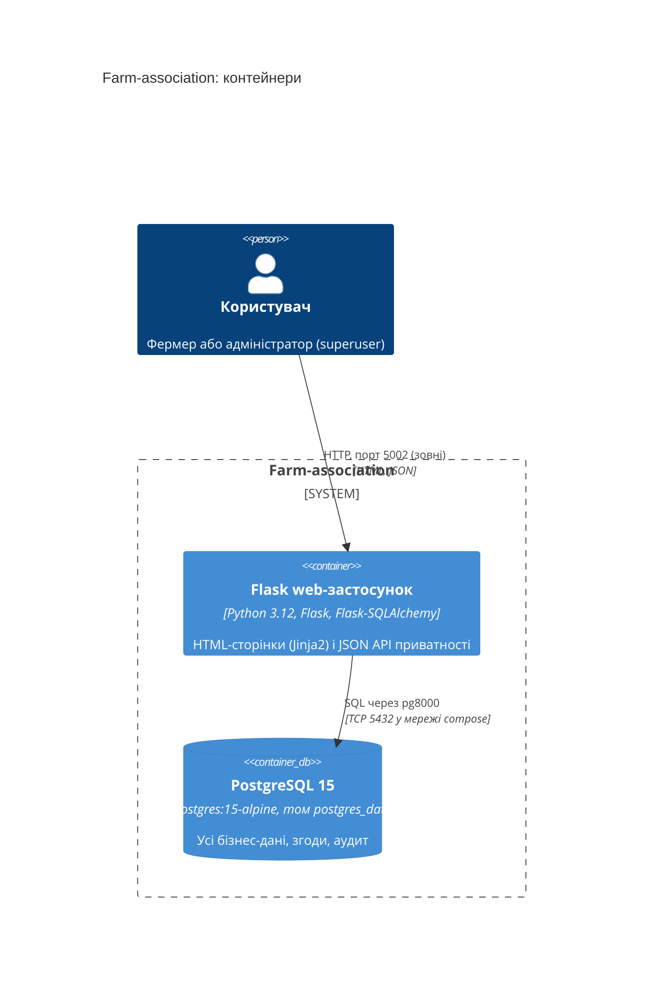
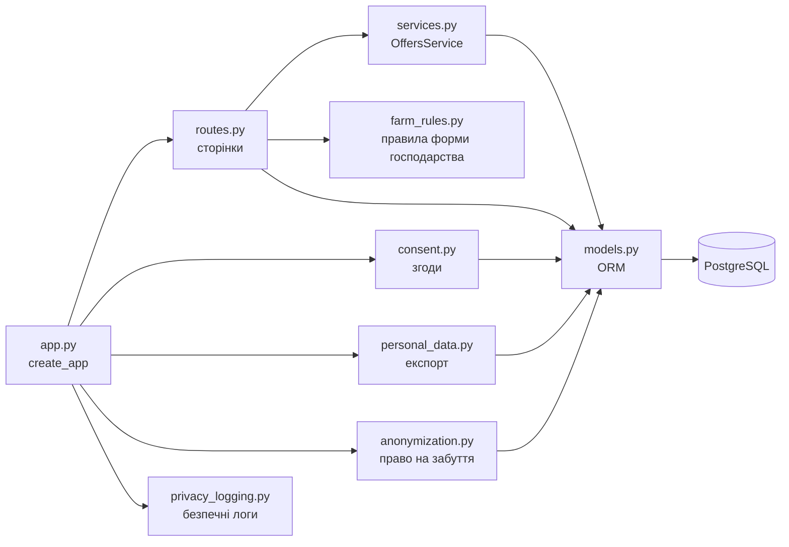
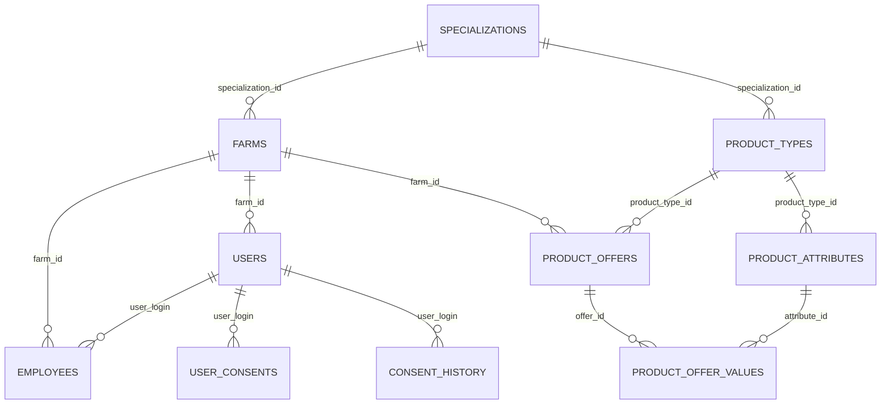

# SDD: System Design Document (Farm-association)

Статус: актуальний · Власник: Denys Brenkach · Остання перевірка: 2026-11-22 · Цикл перегляду: 180 днів
Пов'язані документи: [ISD](isd.md) · [ADR-0001](architecture/adr/0001-postgresql-as-data-store.md) · [ADR-0002](architecture/adr/0002-flask-server-rendered-monolith.md) · [Матриця аудиторій](audience-matrix.md)

## 1. Призначення системи
Веб-платформа асоціації фермерських господарств: господарства ведуть профіль, перелік продукції (пропозиції), працівників і формують звіт по виробниках. Окремий контур приватності (GDPR): згоди, експорт персональних даних, анонімізація, безпечне логування.

## 2. C4: діаграма контейнерів

## 3. Компоненти веб-застосунку

| Компонент | Файл | Відповідальність | Взаємодіє з | Розгортання (ISD) |
|---|---|---|---|---|
| Фабрика застосунку | `app.py` | Конфігурація Flask, підключення БД, `db.create_all()`, створення користувача `admin`, засів довідника спеціалізацій, реєстрація маршрутів | routes, consent, personal_data, anonymization, privacy_logging, models | [ISD §3, §4](isd.md#3-середовища-та-змінні-оточення) |
| Сторінки | `routes.py` | Автентифікація (login, register, reset-password), CRUD господарств, типів продукції, пропозицій, працівників, звіт виробників, перевірка готовності (`/health`) | models, services, farm_rules | [ISD §2](isd.md#2-топологія-розгортання) |
| Сервіс пропозицій | `services.py` | `OffersService`: логіка пропозицій з повтором при збої БД | models | [ISD §2](isd.md#2-топологія-розгортання) |
| Правила форми | `farm_rules.py` | Таблиця правил валідації господарства (`RULES`, `first_error`) | routes | [ISD §2](isd.md#2-топологія-розгортання) |
| Згоди | `consent.py` | `UserConsent`, `ConsentHistory`, `MarketingOutbox`, `ConsentPolicyGate`, API `/api/consents*` | models | [ISD §5](isd.md#5-сховища-даних) |
| Експорт даних | `personal_data.py` | `ExportRequest` (незмінний Value Object), `/api/users/<login>/personal-data` | models, privacy_logging | [ISD §5](isd.md#5-сховища-даних) |
| Анонімізація | `anonymization.py` | Право на забуття в одній транзакції, `AuditEvent` | models, consent | [ISD §5](isd.md#5-сховища-даних) |
| Безпечне логування | `privacy_logging.py` | Маскування PII, correlation ID | app.py | [ISD §7](isd.md#7-моніторинг-і-логування) |
| Модель даних | `models.py`, `extensions.py` | ORM-сутності й підключення SQLAlchemy | PostgreSQL | [ISD §5](isd.md#5-сховища-даних) |

Допоміжні модулі лабораторних робіт (`audit_trail.py`, `privacy_services.py`, `notifiers.py`, `ck_metrics.py`, `halstead_scan.py` та ін.) не входять до Docker-образу і не є частиною робочої системи.

## 4. Модель даних

Окремі таблиці без FK: `marketing_outbox` (повідомлення за логіном), `audit_events` (журнал без PII).

## 5. API-контракти

| Метод і шлях | Компонент | Доступ | Призначення |
|---|---|---|---|
| GET/POST `/login`, GET `/logout`, GET/POST `/register`, GET/POST `/reset-password` | routes | гість | автентифікація |
| GET `/`, GET `/manual`, GET `/forbidden` | routes | сесія | головна, інструкція, відмова |
| GET `/health` | routes | відкритий | перевірка готовності: 200 `{"status": "ok"}`, 503 `{"status": "unavailable"}` при недоступній БД |
| GET/POST `/farms`, GET/POST `/farms/<id>/edit`, GET `/farms/<id>/delete` | routes | за роллю | господарства |
| GET/POST `/product-types`, `/product-types/<id>/attributes`, `/product-types/<id>/edit`, GET `/product-types/<id>/delete`, GET `/attribute/<id>/delete` | routes | за роллю | типи продукції й атрибути |
| GET/POST `/offers`, `/offers/<id>/edit`, GET `/offers/<id>/delete` | routes, services | за роллю | пропозиції |
| GET/POST `/employees`, `/employees/<id>/edit`, GET `/employees/<id>/delete` | routes | за роллю | працівники |
| GET `/reports/producers` | routes | за роллю | звіт виробників |
| GET `/api/consents`, GET `/api/consents/history`, POST `/api/consents/<purpose>/grant`, POST `/api/consents/<purpose>/revoke` | consent | сесія | керування згодами |
| POST `/api/marketing/send-test` | consent | сесія | тестова розсилка з перевіркою згоди |
| GET `/api/users/<login>/personal-data` | personal_data | сам користувач або привілейована роль | експорт даних (403 для чужих) |
| POST `/api/users/<login>/anonymize` | anonymization | сам користувач або привілейована роль | анонімізація (403, 404, 409) |
