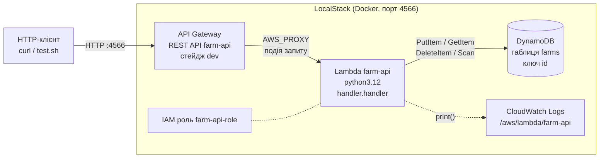
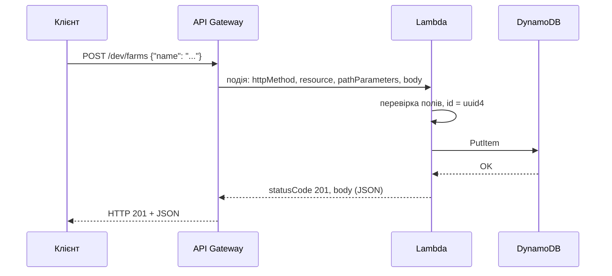

# Farm API: serverless-застосунок у LocalStack

HTTP API для обліку ферм: AWS Lambda (Python 3.12) за Amazon API Gateway (REST API), дані — в Amazon DynamoDB. Усі сервіси AWS емулюються локально в LocalStack, справжній обліковий запис AWS не потрібен.

## Архітектура



Lambda LocalStack запускає в окремому Docker-контейнері, тому до LocalStack змонтовано `/var/run/docker.sock`.

### Шлях запиту



API Gateway працює в режимі **проксі-інтеграції** (`AWS_PROXY`): він не перетворює запит, а передає його у функцію цілком як подію. Функція сама обирає дію за `httpMethod` і `resource` і повертає `statusCode`, `headers` і `body`.

### HTTP API

| Метод | Шлях | Дія | Відповідь |
| --- | --- | --- | --- |
| `POST` | `/farms` | створити ферму | `201` + запис, `400` при помилці у даних |
| `GET` | `/farms` | список ферм | `200` `{"items": [...], "count": N}` |
| `GET` | `/farms/{id}` | отримати ферму | `200` + запис, `404` якщо немає |
| `DELETE` | `/farms/{id}` | видалити ферму | `204`, `404` якщо немає |

Тіло `POST`:

```json
{"name": "Зелена долина", "region": "Чернівецька", "area_ha": 120.5}
```

`name` — обов'язковий непорожній рядок, `region` — рядок, `area_ha` — невід'ємне число. `id` (UUID) і `created_at` (UTC) задає сервер.

### Таблиця DynamoDB `farms`

| Атрибут | Тип | Призначення |
| --- | --- | --- |
| `id` | `S` | ключ розділу (partition key), UUID |
| `name` | `S` | назва ферми |
| `region` | `S` | область |
| `area_ha` | `N` | площа, га (необов'язково) |
| `created_at` | `S` | час створення, ISO 8601 |

Режим оплати `PAY_PER_REQUEST`, тобто без налаштування ємності. DynamoDB вимагає схему лише для ключа; інші атрибути довільні.

## Структура

```
serverless/
├── docker-compose.yml       # LocalStack
├── lambda/handler.py        # код Lambda-функції
├── iam/
│   ├── trust-policy.json    # хто може взяти роль: сервіс Lambda
│   └── farm-api-policy.json # доступ до таблиці farms і до логів
├── scripts/
│   ├── common.sh            # спільні змінні, функція awsl
│   ├── deploy.sh            # розгортання всіх ресурсів
│   ├── test.sh              # перевірка API через curl
│   └── destroy.sh           # видалення ресурсів
└── tests/test_handler.py    # модульні тести функції (pytest + moto)
```

## Розгортання

### 1. Встановлення інструментів (macOS)

```bash
brew install awscli                       # AWS CLI v2
brew install localstack/tap/localstack-cli  # необов'язково: localstack status services
```

Потрібен запущений Docker Desktop.

Використовується образ `localstack/localstack:4.12` — Community-версія, яка працює без облікового запису й токена. Новіші версії LocalStack (з березня 2026) вимагають `LOCALSTACK_AUTH_TOKEN`; для них можна отримати безкоштовний токен плану Hobby на https://app.localstack.cloud і задати його змінною оточення.

### 2. Запуск LocalStack

```bash
cd serverless
docker compose up -d
curl -s http://localhost:4566/_localstack/health | python3 -m json.tool
```

Сервіси `lambda`, `dynamodb`, `apigateway`, `iam` мають бути `available` або `running`.

### 3. Розгортання ресурсів

```bash
./scripts/deploy.sh
```

Сценарій по черзі:

1. створює таблицю DynamoDB `farms` (ключ `id`) і чекає, поки вона стане активною;
2. створює роль IAM `farm-api-role` з політикою доступу до таблиці;
3. пакує `handler.py` у zip, створює функцію `farm-api` (python3.12, архітектура як у процесора хоста) або оновлює її код;
4. створює REST API `farm-api` з ресурсами `/farms`, `/farms/{id}` і методами `GET`, `POST`, `DELETE` з проксі-інтеграцією в Lambda, дає API Gateway дозвіл викликати функцію;
5. публікує API на стейдж `dev` і записує URL у файл `.api-url`.

Повторний запуск безпечний: таблиця й роль перевикористовуються, код функції оновлюється, REST API створюється заново.

Усі команди AWS CLI йдуть у LocalStack через `--endpoint-url http://localhost:4566` (функція `awsl` у `common.sh`) з фіктивними ключами `test/test`.

### 4. Перевірка

```bash
./scripts/test.sh
```

Або вручну:

```bash
URL=$(cat .api-url)/farms
curl -s -X POST "$URL" -H 'Content-Type: application/json' -d '{"name": "Зелена долина", "region": "Чернівецька"}'
curl -s "$URL"
curl -s "$URL/<id>"
curl -s -i -X DELETE "$URL/<id>"
```

Дані в DynamoDB і логи функції (сценарії задають регіон і фіктивні ключі самі, для ручних команд їх треба задати в терміналі):

```bash
export AWS_ACCESS_KEY_ID=test AWS_SECRET_ACCESS_KEY=test AWS_DEFAULT_REGION=us-east-1
aws --endpoint-url http://localhost:4566 dynamodb scan --table-name farms
aws --endpoint-url http://localhost:4566 logs tail /aws/lambda/farm-api --since 10m
```

### 5. Модульні тести функції

```bash
pip install boto3 "moto[dynamodb]" pytest
pytest -q tests
```

### 6. Видалення

```bash
./scripts/destroy.sh
docker compose down
```
